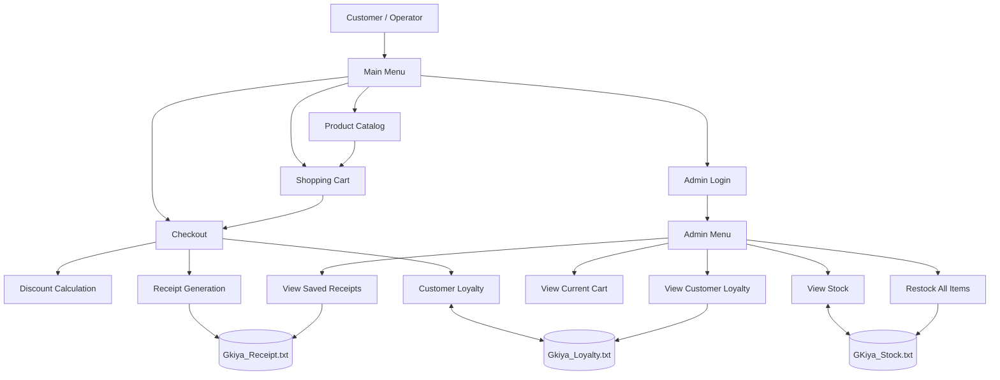

# Gunita't KuhanIyah 📸
### *Mga kuhang binubuhay ng gunita*


**Gunita't KuhanIyah** is a C++ console-based photography and camera accessories shop management system. It allows customers to browse products, add items to their cart, purchase photography accessories, and receive receipts. The system also includes administrator functions for inventory management, receipt viewing, restocking, and customer loyalty tracking.

---

## 📑 Table of Contents

- [About the Project](#-about-the-project)
- [Features](#-features)
- [Screenshots](#-screenshots)
- [Technologies Used](#-technologies-used)
- [System Architecture](#-system-architecture)
- [Product Catalog](#-product-catalog)
- [Discount and Loyalty System](#-discount-and-loyalty-system)
- [Admin Login and Credentials](#-admin-login-and-credentials)
- [How to Compile and Run](#-how-to-compile-and-run)
- [Data Storage](#-data-storage)
- [Project Structure](#-project-structure)
- [Limitations and Future Improvements](#-limitations-and-future-improvements)
- [Creator Information](#-creator-information)

---

## 📖 About the Project

Gunita't KuhanIyah is designed to simulate a simple photography shop using a command-line interface. The system manages product information, shopping cart operations, checkout, discounts, receipts, inventory quantities, and customer loyalty records.

The project demonstrates fundamental C++ programming concepts, including:

- Functions and modular programming
- Arrays and product data management
- Conditional statements and loops
- User input and validation
- File handling for persistent records
- Shopping cart and checkout processing
- Basic authentication for administrator access

---

## ✨ Features

### 🛍️ Customer Features

- **Product Catalog** — Browse available photography products and accessories.
- **Add to Cart** — Select products and quantities for purchase.
- **View Cart** — Review selected items before checkout.
- **Checkout System** — Calculate the order total and apply available discounts.
- **Receipt Generation** — Save purchase receipts to a text file.
- **Customer Loyalty** — Track customer purchase counts and determine loyalty tiers.
- **Inventory Tracking** — Maintain stock quantities for products.

### 🔐 Administrator Features

- **Admin Login** — Authenticate using the configured administrator credentials.
- **View Stock** — Display current product inventory.
- **View Current Cart** — Review the current shopping cart.
- **View Saved Receipts** — Read receipt records stored in the receipt file.
- **Restock All Items** — Set the stock quantity of every product to 50.
- **View Customer Loyalty** — Review saved customer loyalty records.
- **Login Attempt Limit** — Allow a maximum of three login attempts.

---

## 🖼️ Screenshots

Screenshots are stored in the `docs/screenshot/` directory. The following images illustrate the application's main functions.

### 1. Homepage


### 2. Product Catalog


### 3. Add to Cart


### 4. View Cart


### 5. Checkout — Order Summary


### 6. Checkout — Receipt


### 7. Admin Login


### 8. Admin Stock Management


> **Note:** Ensure all eight image files exist in `docs/screenshot/`. GitHub displays the screenshots automatically when the file paths and filenames match. If an image is missing, GitHub will display a broken image link.

---

## 🛠️ Technologies Used

| Technology | Purpose |
|---|---|
| C++ | Main programming language |
| Standard C++ Libraries | Input, output, strings, and file operations |
| Text Files | Persistent storage for stock, receipts, and loyalty records |
| Terminal / Command Prompt | Application interface |
| Git and GitHub | Source code version control and project documentation |

---

## 🏗️ System Architecture

The system is organized around a main menu that directs customers and administrators to the appropriate features. Product inventory, receipts, and loyalty records are stored in text files.



### Main Components

| Component | Description |
|---|---|
| Main Menu | Provides access to customer operations and the admin login. |
| Product Catalog | Stores and displays product names, IDs, prices, and stock quantities. |
| Shopping Cart | Holds selected products and quantities during shopping. |
| Checkout | Calculates totals and applies the selected and loyalty discounts. |
| Receipt System | Writes purchase receipt records to a text file. |
| Inventory System | Reads and updates product stock information. |
| Loyalty System | Maintains customer purchase counts and loyalty tiers. |
| Admin System | Provides access to stock, cart, receipt, restocking, and loyalty functions. |

---

## 📦 Product Catalog

The application includes photography frames, instant cameras, and film products.

| Product ID | Product Name | Price (PHP) | Initial Stock |
|---:|---|---:|---:|
| 101 | Frame 4x6 | ₱50 | 20 |
| 102 | Frame 5x7 | ₱75 | 15 |
| 103 | Frame 8x10 | ₱120 | 10 |
| 104 | GlowFrame | ₱300 | 8 |
| 105 | Collage Frame | ₱450 | 12 |
| 201 | Instax Mini 12 | ₱4,200 | 5 |
| 202 | Instax Mini 90 | ₱6,800 | 4 |
| 203 | Instax SQ1 | ₱5,300 | 6 |
| 301 | Film 10s | ₱350 | 30 |
| 302 | Film 20s | ₱650 | 20 |

> **Note:** The stock values above represent the initial quantities defined in the program. Actual quantities may change during use and may be saved in the stock file.

---

## 🎁 Discount and Loyalty System

The program provides loyalty discounts based on a customer's recorded purchase count.

| Number of Purchases | Loyalty Tier | Loyalty Discount |
|---:|---|---:|
| Fewer than 3 | NONE | 0% |
| 3–4 | SILVER | 3% |
| 5–9 | GOLD | 5% |
| 10 or more | DIAMOND | 10% |

During checkout, the customer can also select an additional discount option of **0%, 10%, or 20%**.

The program adds the selected additional discount percentage to the applicable loyalty discount percentage. Review the checkout calculation in the source code for the exact discount application.

---

## 🔐 Admin Login and Credentials

The system has an administrator login that restricts access to inventory management and other administrative features.

### Default Admin Credentials

| Field | Value |
|---|---|
| Username | `gkiya` |
| Password | `admin123` |
| Maximum Login Attempts | 3 |

### Admin Menu Options

| Option | Feature | Description |
|---:|---|---|
| 1 | View Stock | Displays product information and current stock quantities. |
| 2 | View Current Cart | Displays the items currently in the shopping cart. |
| 3 | View Saved Receipts | Reads and displays the saved receipt records. |
| 4 | Restock All Items | Sets the stock quantity of all products to 50. |
| 5 | View Customer Loyalty | Displays saved customer loyalty records. |
| 6 | Return to Main Menu | Returns to the main menu. |

### Admin Login Process

1. Select the admin option from the main menu.
2. Enter the administrator username.
3. Enter the administrator password.
4. If the credentials are correct, the admin menu becomes accessible.
5. If the credentials are incorrect, try again within the three-attempt limit.

### ⚠️ Security Warning

The administrator username and password are hard-coded in the source code. This is suitable only for a basic academic demonstration, not for a production business system.

**Before publishing this project publicly, consider changing the default credentials.** For a real application, use a more secure authentication method and avoid storing passwords directly in source code.

---

## ▶️ How to Compile and Run

### Prerequisites

- A C++ compiler, such as GCC or MinGW.
- A terminal, Command Prompt, or compatible IDE.
- The project's source file, `FINALPROJ.cpp`.

### 1. Clone the Repository

If your project is hosted on GitHub, run:

```bash
git clone YOUR_REPOSITORY_URL
cd YOUR_REPOSITORY_FOLDER
```

Replace the placeholder values with your actual repository URL and folder name.

### 2. Compile the Program

Using GCC or MinGW:

```bash
g++ -std=c++11 -Wall -Wextra FINALPROJ.cpp -o gkiya
```

### 3. Run the Program

**Windows Command Prompt / PowerShell:**

```powershell
.\gkiya.exe
```

**macOS / Linux:**

```bash
./gkiya
```

> If your compiler produces an executable with a different filename, run the filename generated by your compiler.

---

## 💾 Data Storage

The application uses text files to store selected information between program runs.

| File | Purpose |
|---|---|
| `GKiya_Stock.txt` | Stores product stock information. |
| `Gkiya_Receipt.txt` | Stores generated receipt records. |
| `Gkiya_Loyalty.txt` | Stores customer names and purchase counts for loyalty tracking. |

The files may be created or updated by the program as the corresponding features are used. Keep these files in the expected working directory when running the application.

**Important:** The capitalization of filenames shown above follows the project documentation. Ensure that the actual filenames and references in your source code match, particularly when running on case-sensitive systems.

---

## 📁 Project Structure

```text
Gunita't-KuhanIyah/
├── FINALPROJ.cpp
├── README.md
├── GKiya_Stock.txt
├── Gkiya_Receipt.txt
├── Gkiya_Loyalty.txt
└── docs/
    └── screenshot/
        ├── add-to-cart.png
        ├── admin-login.png
        ├── admin-stock.png
        ├── check-out-1.png
        ├── checkout-2.png
        ├── homepage.png
        ├── products.png
        └── view-cart.png
```

> The text files may not exist until the program creates them. Adjust this structure if your actual repository uses different filenames or directories.

---

## 🚧 Limitations and Future Improvements

Potential improvements for future versions include:

- Better validation for invalid or unexpected user input.
- Secure administrator authentication.
- More precise stock updates based on purchased quantities.
- Improved receipt formatting and receipt history management.
- More flexible restocking options instead of resetting all items to 50.
- A database for product, receipt, and loyalty records.
- A graphical user interface.
- Automated tests for checkout, discounts, and inventory operations.

---

## 👩‍💻 Creator Information

**Agustin, Jeshaiah D.**

- **Program:** BSIT (FULL)
- **Year Level:** First Year
- **Semester:** First Semester
- **Institution:** Technological University of the Philippines – Taguig Campus

---

## 📜 Project Purpose

This project was developed as an academic exercise to demonstrate the use of C++ programming concepts in a simple retail management system.

**Gunita't KuhanIyah** — *Mga kuhang binubuhay ng gunita.* 📸

---
